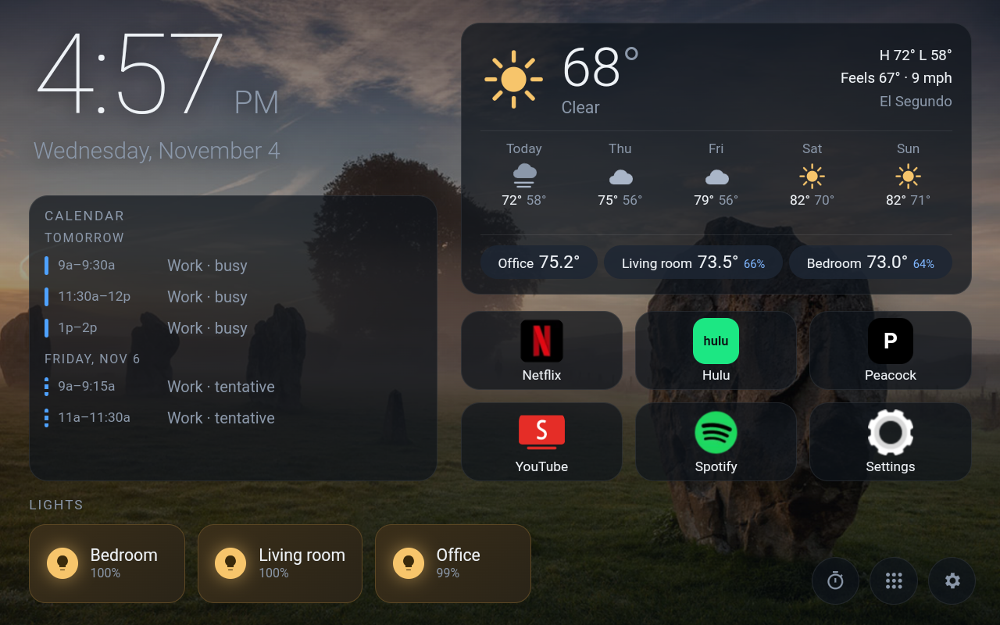

# Echo Show 8 → Kitchen Dashboard

How to turn an **Amazon Echo Show 8 (1st gen, 2019, codename `crown`)** into an Alexa-free kitchen screen:
rooted Fire OS, Amazon's tracking and voice stack removed, and a custom home screen with weather, a calendar,
room temperatures, Hue lights, timers, and Netflix / Peacock / Spotify / YouTube.



This repo is a log of one real build, written up so someone else can follow it. Each module below is independent
after Part 1, so pick the pieces you want. Addresses like `192.168.4.x` and the El Segundo weather location are
ours; swap in your own (the spots to change are listed in [Part 5](#5-kitchen-home-the-custom-home-screen)).

> [!WARNING]
> **Check your Fire OS version first.** The unlock exploit was **patched in Fire OS 6575.1** (Nov 2026).
> 6574.1 and older work. Keep the Echo's **Wi-Fi off** from the moment you decide to do this until it's unlocked,
> or it may auto-update and close the door for good. Read the first post and the last page of the
> [XDA thread](https://xdaforums.com/t/unlock-root-twrp-unbrick-amazon-echo-show-8-1st-gen-2019-crown.4766687/)
> before you start; things change. You can brick the device. You do this at your own risk.

## Contents

| Part | Module | Needs |
|---|---|---|
| 0 | [PC setup](#0-pc-setup) | Windows PC |
| 1 | [Unlock + root](#1-unlock-and-root) | micro-USB data cable |
| 2 | [Block updates + remove Alexa/Amazon](#2-block-updates-and-remove-alexa--amazon) | Part 1 |
| 3 | [Make it fast](#3-make-it-fast) | Part 1 |
| 4 | [Streaming apps](#4-streaming-apps) | Part 1 |
| 5 | [Kitchen Home (the custom home screen)](#5-kitchen-home-the-custom-home-screen) | Part 1, JDK + Android SDK |
| 6 | [Wi-Fi adb + screen mirroring](#6-wi-fi-adb-and-screen-mirroring) | Part 1 |
| 7 | [Room temperature sensors](#7-room-temperature-sensors-raspberry-pi) | a Raspberry Pi + Sense HAT or AM2302/DHT22 |
| 8 | [Temperature history dashboard](#8-temperature-history-dashboard) | Part 7 |
| 9 | [Calendar card](#9-calendar-card) | Part 5 |
| — | [Undo / recovery](#undo-and-recovery), [Known issues](#known-issues), [Repo map](#repo-map) | |

**Echo Show 5 (1st gen, `checkers`)?** Same exploit, different files. See [docs/show5-checkers-notes.md](docs/show5-checkers-notes.md).
**Never** mix crown and checkers/cronos files: same names, different contents, boot loop.

---

## 0. PC setup

1. **Platform Tools** (adb + fastboot) from Google:
   `https://dl.google.com/android/repository/platform-tools-latest-windows.zip` → unzip to `tools/platform-tools/`.
   All scripts in `scripts/` use this copy.
2. **USB driver:** the Amazon Kindle Fire driver (Google's USB driver as a fallback). In fastboot the Echo shows up as
   "Android Bootloader Interface".
3. **Plug straight into a motherboard USB port** with a good data cable. A USB hub caused every stall and dropped transfer we hit.
4. Clone this repo. `tools/`, `downloads/`, `backups/`, `build/` and `keystore/` are gitignored; you fill them yourself.

## 1. Unlock and root

Full checklist with what we saw at each step: [docs/runbook.md](docs/runbook.md).

**Downloads** (XDA attachments, sign in to download), into `downloads/`:
- `amonet-crown-v2.0.2.zip` (post #1 of the unlock thread). Our review against the source: [docs/amonet-package-review.md](docs/amonet-package-review.md).
  Windows Defender may flag it (ML false positive on the exploit tools).
- `boot-root.zip` for **crown** (post #2). Review: [docs/boot-root-review.md](docs/boot-root-review.md).

**Boot modes** (hold the button(s) while plugging in power):

| Mode | Buttons |
|---|---|
| Stock fastboot | all three top buttons |
| Hacked fastboot (after unlock) | Volume Down |
| TWRP recovery (after unlock) | Volume Up |

**Steps:**
1. Wi-Fi off. Power off. Hold all three buttons + plug in power → stock fastboot. Connect USB.
   `scripts\check-device.ps1` should list it; `fastboot getvar product` should say `CROWN`.
2. In the unzipped amonet folder, run `fastbrick.bat` and type `YES`.
   **Don't touch anything once it starts (up to ~5 min). Interrupting it is a permanent brick.**
   It ends by rebooting into TWRP.
3. Back up in TWRP if you can (we saved the small partitions; see the runbook). Turn off the TWRP screen timeout or adb drops.
4. Enter hacked fastboot (`adb reboot bootloader` from TWRP), then:
   ```powershell
   fastboot oem flags 61
   fastboot flash boot downloads\boot-root\boot-root.img
   fastboot reboot
   ```
   Our first boot fell back to fastboot; a second `fastboot reboot` booted Fire OS.
5. In Fire OS: `adb shell settings put global disable_bouncer 1`. `adb shell id` should now show `uid=0` (root).

Option B (LineageOS 18.1 instead of Fire OS) is sketched in the runbook; we stayed on rooted Fire OS
because Netflix's Echo build and the Widevine L1 DRM work there.

## 2. Block updates and remove Alexa / Amazon

**Block updates before you ever turn Wi-Fi on:**
```powershell
adb shell pm disable-user --user 0 com.amazon.device.software.ota
adb shell pm disable-user --user 0 com.amazon.device.software.ota.override
adb shell pm disable-user --user 0 com.amazon.device.smarthome.ota
```

**Remove ~58 Amazon packages** (Alexa voice/UI, Drop In, ad ID, analytics, telemetry, Sidewalk radios, the stock launcher).
The list, with a comment per package, is [config/debloat.txt](config/debloat.txt); edit it to keep anything you want.
```powershell
scripts\debloat.ps1               # remove (pm uninstall -k --user 0; APKs stay in /system)
scripts\debloat.ps1 -Restore      # put everything back
scripts\debloat.ps1 -Restore -Only amazon.speech.sim
```
- Use uninstall-for-user, **not** `pm disable`. Disabled *persistent* apps get relaunched and crash-loop ("SpeechUI has stopped").
- Install a replacement launcher (Part 5) **before** removing `com.amazon.paladin`, or you'll have no home screen.
- A couple of persistent core apps (`amazon.speech.sim`, `davcservice`) came back at boot anyway; we renamed their APKs
  under `/system` (dm-verity is off on this build). That works but leads to the [System UI issue](#known-issues).
- Result: CPU during Peacock playback dropped from 279% to 153% of one core.

## 3. Make it fast

Fire OS installs sideloaded apps **uncompiled** (`interpret-only`), which made Spotify unusable. After every sideload:
```powershell
adb shell cmd package compile -m speed-profile -f com.spotify.music   # big apps
adb shell cmd package compile -m speed -f com.kitchenhome             # small apps
```
Also turn animations off:
```powershell
adb shell settings put global window_animation_scale 0
adb shell settings put global transition_animation_scale 0
adb shell settings put global animator_duration_scale 0
```
Turn off Spotify Canvas, and close scrcpy when you're not using it.

## 4. Streaming apps

The Echo is Android 7.1.2 (API 25), 32-bit ARM (`armeabi-v7a`), 1280×800. Install with `adb install`, then compile (Part 3).

| Service | How | Notes |
|---|---|---|
| Netflix | preinstalled Echo build | keep it; works with the DRM |
| YouTube | [SmartTube](https://github.com/yuliskov/SmartTube) (armeabi-v7a APK from GitHub) | no ads |
| Spotify | APKMirror `.apkm`: `adb install-multiple base.apk split_config.armeabi_v7a.apk split_config.en.apk split_config.tvdpi.apk` | sign-in opens Kitchen Home's browser |
| Peacock | **website** in Kitchen Home's built-in browser | ~540p; the Android apps are retired or 64-bit only |
| Hulu | website tile (the Fire tablet app needs an Appstore entitlement) | untested after sign-in |

Peacock needed tricks: Kitchen Home's browser reports desktop Chrome 131 and maps the Widevine `SW_SECURE_DECODE`
request to `SW_SECURE_CRYPTO`. Details are in the runbook (Kitchen Home 0.3/0.4).

## 5. Kitchen Home (the custom home screen)

A tiny Android app (`com.kitchenhome`) that is the HOME screen and shows a local HTML dashboard in a WebView.
Clock, weather (Open-Meteo, no key), calendar, room temps, 6 app tiles, Hue lights pop-up, kitchen timers that ring over
other apps, now playing controls, rotating photo background, optional screensaver, and a built-in browser.
Feature list and internals: [app/kitchen-home/README.md](app/kitchen-home/README.md).

**Build tools** (no Gradle, no Android Studio), unzipped into `tools/`:
- JDK 17 (we used Eclipse Temurin 17) → `tools/jdk/<jdk folder>/`
- Android command-line tools → `tools/android-sdk/cmdline-tools/latest/`, then
  `sdkmanager "build-tools;34.0.0" "platforms;android-34"` so you have `tools/android-sdk/build-tools/34.0.0` and `platforms/android-34`.

**Make it yours** before building:

| What | Where |
|---|---|
| Weather location | `app/kitchen-home/assets/app.js` (`lat`, `lon`, `place`, `tz`) and the placeholder in `index.html` |
| Room sensor addresses | `features.js` → `sensorAddrs` default (also editable on the Echo in ⚙ Settings) |
| Home Assistant address | `features.js` → `haUrl` default (also in ⚙ Settings) |
| Temperature logger address | `dashboard.js` → `loggerUrl` |

Everything else (Hue pairing, app tiles, calendars, HA token) is set on the Echo in ⚙ Settings and stored only there.

**Build, install, make it home:**
```powershell
scripts\build-kitchen-home.ps1 -Install     # creates a signing key in keystore/ the first time; keep it
adb shell cmd package set-home-activity com.kitchenhome/.MainActivity
adb shell pm grant com.kitchenhome android.permission.READ_EXTERNAL_STORAGE
adb shell pm grant com.kitchenhome android.permission.WRITE_EXTERNAL_STORAGE
adb shell settings put secure enabled_notification_listeners com.kitchenhome/com.kitchenhome.MediaListener
```
- **Hue:** ⚙ Settings → Connect Hue bridge, then press the bridge's button.
- **Your photos:** copy them to `Pictures/KitchenHome` on the Echo (File Explorer → Echo Show 8 → Internal Storage).
- **Debug the dashboard:** `chrome://inspect` on the PC with the Echo on USB.

## 6. Wi-Fi adb and screen mirroring

- **Mirror and control the Echo from the PC** (handy for typing passwords): [scrcpy](https://github.com/Genymobile/scrcpy) unzipped into `tools/`,
  then `scripts\echo-screen.ps1`. Ctrl+V pastes the PC clipboard; Alt+H is Home.
- **adb over Wi-Fi** (no cable):
  ```powershell
  adb shell setprop persist.adb.tcp.port 5555
  adb tcpip 5555
  scripts\echo-connect.ps1 -EchoIp <echo ip>
  ```
  ⚠ With the rooted boot image this is **unauthenticated root adb for anything on your LAN**. Only do it on a trusted network.
  Undo: `adb shell setprop persist.adb.tcp.port ""`, then `adb usb`. Reserve the Echo's IP in your router.

## 7. Room temperature sensors (Raspberry Pi)

Each Pi runs a tiny stdlib-only HTTP service, `http://<pi>:8765/reading` → JSON, and Kitchen Home shows one pill per room
on one line, to a tenth of a degree. Supported sensors:

| `SENSOR=` | Hardware |
|---|---|
| `sensehat` | Raspberry Pi Sense HAT |
| `dht22-iio` | AM2302/DHT22 via the kernel driver (recommended): run `pi/enable-dht-overlay.sh`, reboot |
| `dht22` | AM2302/DHT22 via a Python library |

AM2302 wiring we used: **+ → pin 1 (3.3 V), out → pin 7 (GPIO4), − → pin 6 (GND)**. Pins 1 and 7 are on the *inner* header row
(the odd pins); our first try on the outer row read nothing.

Install from the PC (needs SSH keys: `scripts\copy-ssh-key.ps1`):
```powershell
scp -r pi\kitchen-sensor pi@<pi>:~/
ssh pi@<pi> "bash ~/kitchen-sensor/install.sh 'Office' sensehat"
```
Calibrate in `/etc/kitchen-sensor.conf` (`OFFSET_C`, `CPU_K` for a HAT sitting on the Pi) or on the Echo with a `=+1.4` °F suffix.
A sensor already in **Home Assistant** works too: add `ha:<name>` in Settings plus a long-lived HA token.
All of this, including our Home Assistant OS quirks: [pi/README.md](pi/README.md).

## 8. Temperature history dashboard

`pi/temp-logger` runs on one Pi, polls every room (and outside, from Open-Meteo) every 5 minutes into SQLite,
and serves `:8766/history`. Tap the room temperatures on the Echo for 24 h / 7 day / 30 day charts.
```powershell
scp -r pi\temp-logger pi@<pi>:~/
ssh pi@<pi> "bash ~/temp-logger/install.sh"
```
Then edit `/etc/kitchen-logger/sources.json` (start from [sources.example.json](pi/temp-logger/sources.example.json)).
For a Home Assistant source, `scripts\set-logger-token.ps1` asks for the token (hidden) and writes it on the Pi only.

## 9. Calendar card

Shows today + the next 3 days from any number of calendars, merged, under the clock.
- **Google:** calendar settings → Integrate calendar → *Secret address in iCal format*.
- **Outlook / Microsoft 365:** Outlook on the web → Settings → Calendar → Shared calendars → Publish a calendar → ICS link.
- Paste each link on the Echo in ⚙ Settings → **Calendars** (scrcpy + Ctrl+V). Links stay on the Echo, never in the repo.
- **Work calendar only publishes free/busy?** The [phone calendar relay](pi/phone-calendar/README.md) uses an iPhone Shortcut
  to send your phone's events to a Pi, which serves them back as an iCal feed.

## Undo and recovery

- **Re-enable any Amazon package:** `scripts\debloat.ps1 -Restore` (or `-Only <pkg>`), and `adb shell pm enable <pkg>` for the OTA packages.
- **Boot loop after a package change:** boot TWRP (Volume Up), then `adb shell rm /data/system/users/0/package-restrictions.xml`.
  This resets *every* per-user install/enable state, including the OTA block, so re-block updates before Wi-Fi.
- **Back to the stock launcher:** `adb shell cmd package install-existing com.amazon.paladin`.
- **Brick / restore stock:** the XDA thread has `restore-stock-crown.zip` and the USBDL unbrick (Mute + Volume Down).
- In TWRP, wipe **only** system, data and cache. Never touch lk, preloader or tee.

## Known issues

- **"System UI has stopped"** can pop up after the deep debloat: Amazon's System UI waits for a speech service we removed.
  We're still working on it; restoring `amazon.speech.sim` makes it go away at the cost of the CPU savings.
- Peacock is capped around 540p (WebView only gets software-secure Widevine).
- Hulu playback hasn't been tested yet.

## Repo map

```
app/kitchen-home/      the home screen app (Java + HTML/JS/CSS), README with all features
config/debloat.txt     packages removed in Part 2
docs/runbook.md        the full step-by-step log with everything we hit
docs/*-review.md       what we checked in the amonet and boot-root downloads before running them
docs/show5-checkers-notes.md   Echo Show 5 1st gen notes
pi/                    sensor service, temperature logger, phone calendar relay, Pi notes
scripts/               build, debloat, connect, mirror, DevTools helpers (PowerShell, Windows)
```

## Credits

- Unlock, TWRP and boot-root by **Rortiz2 (R0rt1z2)**: [XDA thread](https://xdaforums.com/t/unlock-root-twrp-unbrick-amazon-echo-show-8-1st-gen-2019-crown.4766687/),
  [amonet source](https://github.com/R0rt1z2/amonet/tree/mt8163-echo-show).
- [Derek Seaman's guide](https://www.derekseaman.com/2025/11/home-assistant-hacking-your-echo-show-5-and-8.html).
- [LineageOS 18.1 for crown](https://xdaforums.com/t/rom-unofficial-11-crown-lineageos-18-1-for-the-amazon-echo-show-8-2019.4766709/), [device tree](https://github.com/amazon-oss/android_device_amazon_crown).
- Weather from [Open-Meteo](https://open-meteo.com/); background photos from Bing's daily image.
