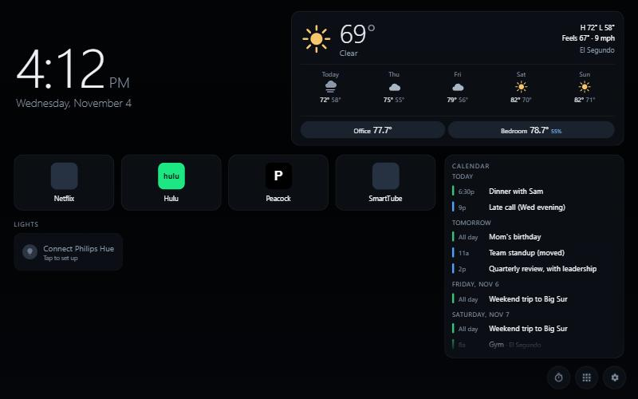

# Kitchen Home

A custom home screen for the unlocked Echo Show 8. It's a tiny Android app (`com.kitchenhome`) that registers
as the HOME activity and shows a local HTML dashboard in a full-screen WebView.


## What's on it

- **Clock and date**
- **Weather** for ZIP 90245 (El Segundo) from [Open-Meteo](https://open-meteo.com/). It needs no API key, refreshes every 15 minutes, and falls back to the last cached forecast when offline.
- **Six app tiles**, configurable in Settings. Defaults: Netflix, Hulu, Peacock, YouTube (SmartTube), Spotify, Settings.
- **Philips Hue rooms**, via the bridge's local v1 API. Tap a room to toggle it; long-press for brightness.
- **All-apps drawer** and **Settings**: Hue pairing, tile picker, and a night dim from 10 pm to 6 am.
- **Rotating photo background** (0.5): a slow cross-fade with a gentle zoom, changing every 60 s. Sources:
  - Bing's recent daily images (no key; toggle in Settings)
  - your own photos copied to **`/sdcard/Pictures/KitchenHome`** (Explorer: Echo Show 8 → Internal Storage → Pictures → KitchenHome)
- **Kitchen timers** (0.5): the stopwatch button opens presets (1–60 min) or a custom ±1/±5 timer. Running timers show as chips under the clock; tap ✕ to cancel.
  Each timer is also scheduled with `AlarmManager` (`TimerReceiver`), so it **brings Kitchen Home to the front and rings even while Peacock/Spotify is open**.
  The alarm is a full-screen flash with WebAudio beeps, Stop or +1 min.
- **Now playing** (0.5): album art, title and artist, with prev/play-pause/next for whatever app has an active media session (Spotify, SmartTube).
  This needs the notification listener (`MediaListener`) enabled; see setup below.
- **Idle screensaver** (0.5, **off by default** since the user prefers the dashboard always up; turn it on in Settings → Display): after 5 min (configurable) without a touch, a full-screen slideshow with a big clock, date and weather. Tap to wake. Not shown while a timer is ringing or a panel is open.

## Calendar card



`assets/calendar.js` shows **today + the next 3 days** from Outlook and Google, merged and sorted, with a colour bar per calendar.
It sits right of the app tiles, so the home row now holds **4 tiles**. YouTube and Android Settings were dropped by a one-time
migration (`tiles.calMigrated`): YouTube is still in the all-apps drawer, and Settings is behind the gear.

- **Source:** each calendar's private iCal (`.ics`) link, pasted on the Echo in ⚙ Settings → **Calendars** (use scrcpy + Ctrl+V).
  Links are stored only in the Echo's WebView `localStorage` (`cal.feeds`), never in this repo.
  - **Outlook / Microsoft 365:** Outlook on the web → Settings → Calendar → **Shared calendars** → *Publish a calendar* →
    pick the calendar, **Can view all details**, Publish → copy the **ICS** link. (Work tenants can disable publishing; then Microsoft Graph is the fallback.)
  - **Google:** calendar.google.com → ⚙ Settings → click the calendar under *Settings for my calendars* → **Integrate calendar** →
    **Secret address in iCal format**. Add one row per Google calendar (each has its own secret address).
  - `webcal://` links are accepted (rewritten to `https://`).
- **Refresh:** every 10 min, plus "Refresh now" in Settings. Each feed's expanded occurrences are cached (`cal.cache`), so the card still
  shows events offline, and a failing feed shows "N calendars not updating" in the card header. Status per feed is shown in Settings.
- **Parser:** line folding, `TZID` (IANA plus common Windows names Outlook emits, such as *Pacific Standard Time*), UTC/floating times, all-day and
  multi-day events (shown on each day they cover), `DURATION`, `RRULE` DAILY/WEEKLY/MONTHLY/YEARLY with `INTERVAL`, `COUNT`, `UNTIL`,
  `BYDAY` (incl. `2TU`, `-1FR`), `BYMONTHDAY`, `BYMONTH`, `BYSETPOS`, plus `EXDATE`, `RECURRENCE-ID` overrides and `STATUS:CANCELLED`.
  The same meeting on two calendars (same title + start) is shown once. Finished events drop off today; the current one is highlighted.
- **Fetching:** works on the device without a proxy because the WebView loads from `file://` with universal access (no CORS).
  In a desktop browser, serve `app/kitchen-home` over HTTP and use the samples in `test/`:
  `python -m http.server 8790 --directory app/kitchen-home`, open `http://127.0.0.1:8790/assets/index.html`, and add
  `http://127.0.0.1:8790/test/sample-outlook.ics` and `.../sample-google.ics` as calendars.

## Layout

```
AndroidManifest.xml          HOME + LAUNCHER activity, minSdk 25, cleartext allowed (Hue bridge is http on the LAN)
src/com/kitchenhome/         MainActivity: WebView plus the `Native` JS bridge (launch, apps, icon, installed, settings, brightness)
assets/index.html, style.css, app.js, features.js, calendar.js
test/sample-*.ics            sample Outlook/Google feeds for desktop testing (not used on the device)
res/mipmap-xxhdpi/           generated launcher icon
```

## Build and install

```powershell
scripts\build-kitchen-home.ps1 -Install
```

No Gradle: the script runs aapt2, javac, d8, zipalign and apksigner from `tools/` (JDK 17 plus Android build-tools 34).
The signing key is created once in `keystore/` (gitignored); keep it, or updates won't install over the existing app.

Make it the home screen (already done on the device):

```powershell
adb shell cmd package set-home-activity com.kitchenhome/.MainActivity
```

Olauncher is still installed as a fallback: `adb shell cmd package set-home-activity app.olauncher/.MainActivity`.

One-time permissions (already done on the device):

```powershell
adb shell pm grant com.kitchenhome android.permission.READ_EXTERNAL_STORAGE
adb shell pm grant com.kitchenhome android.permission.WRITE_EXTERNAL_STORAGE
adb shell settings put secure enabled_notification_listeners com.kitchenhome/com.kitchenhome.MediaListener
```

## Debugging

WebView remote debugging is on. With the Echo on USB, open `chrome://inspect` on the PC to get DevTools for the dashboard.

## Hue

The bridge is at `192.168.4.2` (BSB002, API 1.78). Pairing stores the bridge IP and API username in the WebView's localStorage on the Echo.
