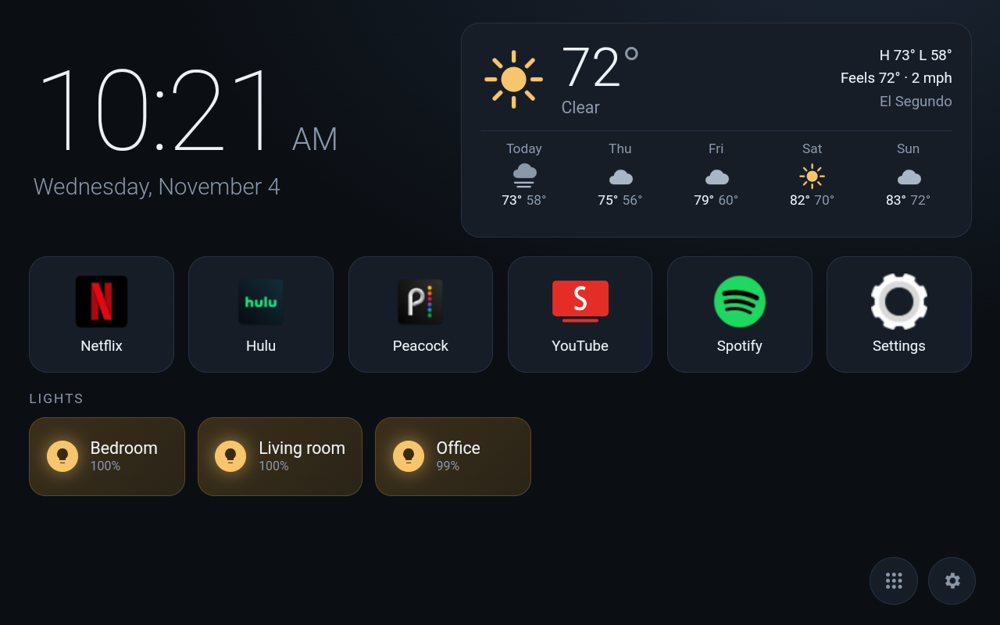

# Kitchen Home

A custom home screen for the unlocked Echo Show 8. It's a tiny Android app (`com.kitchenhome`) that registers
as the HOME activity and shows a local HTML dashboard in a full-screen WebView.



## What's on it

- **Clock and date**
- **Weather** for ZIP 90245 (El Segundo) from [Open-Meteo](https://open-meteo.com/). It needs no API key, refreshes every 15 minutes, and falls back to the last cached forecast when offline.
- **Six app tiles**, configurable in Settings. Defaults: Netflix, Hulu, Peacock, YouTube (SmartTube), Spotify, Settings.
- **Philips Hue rooms**, via the bridge's local v1 API. Tap a room to toggle it; long-press for brightness.
- **All-apps drawer** and **Settings**: Hue pairing, tile picker, and a night dim from 10 pm to 6 am.

## Layout

```
AndroidManifest.xml          HOME + LAUNCHER activity, minSdk 25, cleartext allowed (Hue bridge is http on the LAN)
src/com/kitchenhome/         MainActivity: WebView plus the `Native` JS bridge (launch, apps, icon, installed, settings, brightness)
assets/index.html, style.css, app.js
res/mipmap-xxhdpi/           generated launcher icon
```

## Build and install

```powershell
scripts\build-kitchen-home.ps1 -Install
```

No Gradle: the script runs aapt2, javac, d8, zipalign and apksigner from `tools/` (JDK 17 plus Android build-tools 34).
The signing key is created once in `keystore/` (gitignored); keep it, or updates won't install over the existing app.

Make it the home screen (already done on the device):

```powershell
adb shell cmd package set-home-activity com.kitchenhome/.MainActivity
```

Olauncher is still installed as a fallback: `adb shell cmd package set-home-activity app.olauncher/.MainActivity`.

## Debugging

WebView remote debugging is on. With the Echo on USB, open `chrome://inspect` on the PC to get DevTools for the dashboard.

## Hue

The bridge is at `192.168.4.2` (BSB002, API 1.78). Pairing stores the bridge IP and API username in the WebView's localStorage on the Echo.
